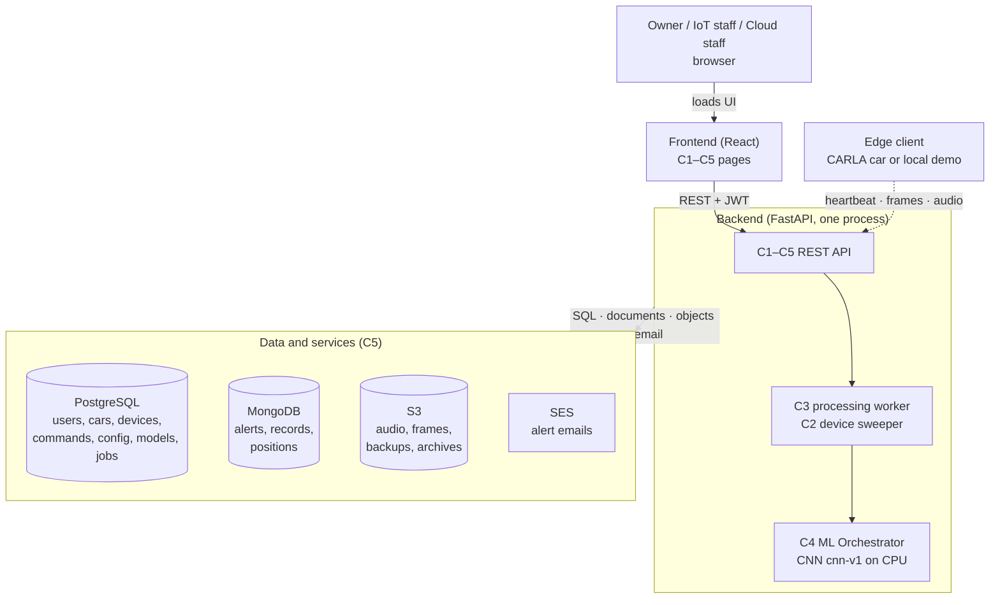

# Intelligent Cloud Platform for Smart Cars

CMPE 281, Group 8. A cloud platform that listens through microphones in cars, classifies sounds
such as sirens, crashes and screams with a CNN, and turns them into alerts for car owners and
cloud staff. It also manages the in-car devices and shows cars live on a map.

The design follows *Component Design for Intelligent Cloud Platform for Smart Cars* (Group 8).

## Components

| Component | What it does | Pages (frames) | Owner |
|---|---|---|---|
| **C1** System Dashboard | Login and roles, owner and fleet dashboards, alert subscriptions, live map, route playback | F1, F2, F3, F6, F9, F10 | Pavan |
| **C2** IoT Device Manager | Device registration with one-time keys, encrypted Wi-Fi, commands, heartbeats, camera frames, Simulator | F4, F5, F11 | Rishi Sheth |
| **C3** Data Management | Audio upload and validation, durable processing queue, retries, Device data monitor | F13 | Rishi Sheth |
| **C4** Alert Tracking and ML Orchestrator | CNN classification, anomaly flag, severity, alerts, email and in-app notifications | F12, F7 | Anusha Tulasi |
| **C5** Database Management and Configuration | Data layer for all components, alert types, model versions, store health, backups, retention | F8a, F8b, F14 | Anusha Tulasi |

Roles:
- **Owners** see their own cars and alerts.
- **IoT staff** manage devices and the Simulator.
- **Cloud staff** see everything, and manage configuration and the database.

## How it works



**One sound, end to end:**
1. **Capture (C2/C3).** An edge client (a CARLA car or the local demo) uploads a clip to
   `POST /device-data`. C3 validates it, stores it in S3 and queues a record.
2. **Classify (C4).** The processing worker claims the record. The orchestrator builds a log-mel
   spectrogram, classifies it into one of five categories, and flags it as an anomaly if its
   confidence is below the threshold.
3. **Alert (C4).** One alert is stored per clip, and the owner is notified by email (SES) or in
   the app, if they're subscribed.
4. **Act (C1/C4).** It appears in the alerts drawer, the dashboards and the map. Owners acknowledge
   it, and cloud staff resolve it.
5. **Configure (C5).** Cloud staff tune alert types, the model and its threshold, and look after
   the databases.

---

## Getting started

| I want to… | Go to |
|---|---|
| Run everything on my laptop | [`infra/README.md`](infra/README.md): without Docker (Homebrew + MinIO) or all in Docker |
| Deploy to AWS | [`infra/aws/SETUP.md`](infra/aws/SETUP.md) (scripts, frontend on S3) or [`infra/aws/docker/SETUP.md`](infra/aws/docker/SETUP.md) (Docker on EC2) |
| Fill every page with demo data | [`infra/README.md` → Demo data](infra/README.md#demo-data) |
| Connect CARLA | [`infra/README.md` → Edge clients and CARLA](infra/README.md#edge-clients-and-carla) |

Sign in with a seeded account. These are development only; the passwords are public in this
repository:

| Account | Password | Role |
|---|---|---|
| `owner@autosound.dev` | `owner-dev-pass` | owner (cars 1–3) |
| `owner2@autosound.dev` | `owner2-dev-pass` | owner (car 4) |
| `iot@autosound.dev` | `iot-dev-pass` | IoT staff |
| `cloud@autosound.dev` | `cloud-dev-pass` | cloud staff (everything) |

## Documentation

| Document | Contents |
|---|---|
| [`backend/README.md`](backend/README.md) | Configuration, roles, every API endpoint by component, the processing pipeline, code layout |
| [`frontend/README.md`](frontend/README.md) | Every page by component, roles and access, the API layer, code layout |
| [`infra/README.md`](infra/README.md) | Local setups, seeded accounts, demo data, live verification, edge clients and CARLA |
| [`infra/aws/SETUP.md`](infra/aws/SETUP.md) · [`infra/aws/docker/SETUP.md`](infra/aws/docker/SETUP.md) | Complete AWS deployment, option A · option B |
| [`backend/edge/README.md`](backend/edge/README.md) | Edge clients: configuration, commands, audio scenarios, buffering |

---

## ML model

One small CNN classifies a 4-second clip into the five alert categories: **emergency, in_vehicle,
human, traffic, environmental**. The training code is in [`model/`](model/), and the backend
serves [`model/artifacts/cnn-v1/`](model/artifacts/cnn-v1/).

### Data
The course-provided `Audio_Datasets`: 1,705 clips after cleaning.

| Category | Source folders | Clips |
|---|---|---|
| emergency | Emergency_sirens (ambulance recordings only) | 289 |
| in_vehicle | car_crash_dataset, glass_breaking_dataset | 215 |
| human | Human_Scream | 745 |
| traffic | road_traffic_dataset | 121 |
| environmental | Environmental_Sounds | 335 |

The split is 70/15/15, **by recording group**, so augmented copies of a recording never end up in
both training and test.

### Pipeline
- **Preprocessing:** 16 kHz mono, fixed to 4 s (keeping the loudest window of a longer clip), then a
  128-bin log-mel spectrogram `[1, 128, 126]`, normalised per clip.
- **Architecture:** 3 × (Conv → BatchNorm → ReLU → MaxPool), then pooling, dropout and a linear
  layer. It has **28,533 parameters** (about 120 KB), and runs on CPU.
- **Training:** Adam, class-weighted loss, with the best epoch chosen by validation balanced
  accuracy.

All preprocessing values are written to the artifact's `config.json`. A test checks that the
backend's preprocessing matches training exactly.

### Results (held-out test set)

| Accuracy | Balanced accuracy | Macro F1 | Latency |
|---|---|---|---|
| **0.839** | 0.830 | 0.812 | ~9 ms per clip on CPU (target: 2 s) |

| Category | Precision | Recall | F1 |
|---|---|---|---|
| emergency | 0.854 | 0.875 | 0.864 |
| in_vehicle | 0.542 | 0.813 | 0.650 |
| human | 0.971 | 0.902 | 0.935 |
| traffic | 0.857 | 0.900 | 0.878 |
| environmental | 0.825 | 0.660 | 0.733 |

- The main error is car-door sounds (environmental) predicted as in_vehicle.
- **Anomaly threshold 0.75**, chosen on the validation set. At that threshold, 20.5% of test clips
  are flagged "review", and those include 68% of the wrong predictions. Unflagged clips are 93.6%
  accurate.
- Cloud staff can tune the threshold in F8b, within 0.50–0.95.
- Full reports:
  [`evaluation_report.json`](model/checkpoints/evaluation_report.json),
  [`confusion_matrix.png`](model/checkpoints/confusion_matrix.png),
  [`training_summary.json`](model/checkpoints/training_summary.json).

### Retrain
These need the raw dataset, which isn't in git:
```bash
pip install -r model/requirements.txt
python -m model.dataset_prep                       # Audio_Datasets/ -> model/data/
python -m model.train                              # -> model/checkpoints/cnn_weights.pth
python -m model.evaluate                           # -> evaluation_report.json, confusion_matrix.png
python scripts/export_model.py --version cnn-v2    # -> model/artifacts/cnn-v2/
```

## Model management scripts

A model version is a folder, `model/artifacts/<version>/` (`model_weights.pt`, `labels.json`,
`config.json`), plus a row in the `model_versions` table. The backend serves the **active** one.

| Script | What it does |
|---|---|
| [`scripts/export_model.py`](scripts/export_model.py) | Packages the trained checkpoint as a version folder. It checks the preprocessing and label order first. |
| [`scripts/make_dummy_model.py`](scripts/make_dummy_model.py) | A random-weight version folder, for running without a trained model. It never overwrites real weights unless you pass `--force`. |

**Deploying a new version:**
1. Create its folder with `export_model.py`.
2. Add a row to `MODEL_VERSIONS` in [`backend/app/db/seed.py`](backend/app/db/seed.py) with
   `is_active: False`, then rerun `python -m app.db.seed`. The seed never creates a second active
   model.
3. Commit, and deploy the code.
4. Press **Activate** in F8b. Activation is one transaction, the weights reload before the next
   clip, and a failed load switches back to the previous model.
5. **To roll back,** activate the previous version in F8b. Existing alerts keep the model version
   that created them.

---

## Tests

```bash
cd backend && python -m pytest     # 528 passed, 10 skipped; no databases, AWS or CARLA needed
cd frontend && npm run build       # the frontend has no unit tests; the build must pass
```

- The backend tests run on SQLite, mongomock and stubbed S3/SES. They cover every component's
  rules and owner scoping, the queue and retries, model activation, backups and retention. They
  also check that preprocessing matches training.
- The 10 skipped tests need a throwaway PostgreSQL database in `TEST_DATABASE_URL`.
- To check a running system end to end, use
  [`scripts/verify_components.py`](infra/README.md#live-verification).

## Repository layout

```
backend/    FastAPI API for C1–C5: routers, services, ml/, db/ (models, repositories, migrations,
            seed), tests/, and edge/ (local and CARLA edge clients)
frontend/   React 18 + Vite 7 UI: every page of C1–C5
model/      CNN training and evaluation, checkpoints, and the packaged artifact cnn-v1
scripts/    model packaging, demo data (demo_data.py, make_local_audio.py), verify_* checks
infra/      local Docker stacks, AWS deployment (aws/), CARLA launcher (carla/)
```
