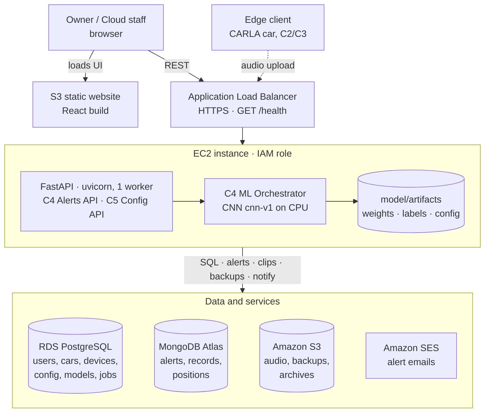

# Intelligent Cloud Platform for Smart Cars: Components C4 and C5

CMPE 281, Group 8. Component submission by **Anusha Tulasi**, branch `feature/component-c4c5`.

| Component | Sidebar page | Frames | Requirements |
|---|---|---|---|
| **C4 Alert Tracking and ML Orchestrator** | Alerts (+ alerts drawer) | F12, F7 | FR-2, FR-5, FR-6, FR-7 |
| **C5 Database Management and Configuration** | Config | F8a, F8b, F14 | FR-8, FR-9 (database support for all) |

The design follows *Component Design for Intelligent Cloud Platform for Smart Cars* (Group 8),
chapters C4 and C5. C1 (dashboard, login), C2 (devices) and C3 (data ingestion) belong to
teammates and are not part of this submission. See [Scope and dependencies](#scope-and-dependencies).

---

## What is in this submission

### C4: Alert Tracking and ML Orchestrator
- **ML orchestrator**
  ([`backend/app/services/orchestrator.py`](backend/app/services/orchestrator.py), [`backend/app/ml/`](backend/app/ml/))
  - `handle_record(record)`: downloads the clip, builds a log-mel spectrogram, classifies it with
    one 5-class CNN, sets `is_anomaly` (confidence below the active model's threshold) and the
    severity from `alert_type_config`, then upserts **one alert per `record_id`** and notifies
    the owner.
  - `preprocess_and_classify(path)`: the same pipeline for one file, used by tests and the CLI.
- **Model** ([`model/`](model/)): training, evaluation and the packaged artifact
  `model/artifacts/cnn-v1` (weights, `labels.json`, `config.json`).
  - Test accuracy **0.839**, balanced accuracy 0.830, macro F1 0.812.
  - About 9 ms per clip on CPU, against the 2 s target.
  - Anomaly threshold **0.75**, picked from validation calibration.
  - Full details in [ML model](#ml-model).
- **Notifications** ([`notification_service.py`](backend/app/services/notification_service.py))
  - Only sends when the owner's subscription for that car and category is enabled.
  - `email` goes through AWS SES (only logged locally while `DEV_FAKE_EMAIL=true`).
  - `in_app` alerts show up in the alerts drawer.
- **Alerts API** ([`routers/alerts.py`](backend/app/routers/alerts.py)): `GET /alerts`,
  `GET /alerts/summary`, `GET /alerts/{id}`, `PUT /alerts/{id}`, `GET /alerts/{id}/audio`.
- **UI**
  - **F12 Alerts list**: filters, 20 rows per page, "review" tag on anomalies, Ack/Resolve.
  - **F7 Alert detail**: facts, class probabilities, audio player, status and note.
  - **Alerts drawer**: every `new` alert, polled every 5 s.

### C5: Database Management and Configuration
- **Data layer** ([`backend/app/db/`](backend/app/db/)): PostgreSQL and MongoDB clients, an S3
  wrapper, the SQLAlchemy models, the Alembic migration `0001_initial_schema` (7 tables), Mongo
  indexes, and **all repositories**. These are the only code that queries a store (BR-5.1).
- **Config API**
  - [`admin_config.py`](backend/app/routers/admin_config.py): alert types, model versions,
    threshold, and model activation in one transaction (DT-CF-1).
  - [`admin_db.py`](backend/app/routers/admin_db.py): health, stats, backups, and retention with
    archive-before-delete.
- **UI** ([`frontend/src/pages/config/`](frontend/src/pages/config/))
  - **F8a Alert types**
  - **F8b Models**: activate, and threshold limits 0.50–0.95
  - **F14 Database**: health cards refreshed every 30 s, stores table, Run backup now, retention
    form with dry run on by default
- **Seed data** ([`backend/app/db/seed.py`](backend/app/db/seed.py)): 4 users, 4 cars, 5 devices,
  5 alert types, the active `cnn-v1` model and 25 alerts.

---

## ML model

One small CNN classifies a 4-second clip into the five alert categories. The code is in
[`model/`](model/). The trained model the backend serves is
[`model/artifacts/cnn-v1/`](model/artifacts/cnn-v1/).

### Dataset
- **Source:** the course-provided `Audio_Datasets`. [`model/dataset_prep.py`](model/dataset_prep.py)
  converts every clip to 16 kHz mono WAV and writes `model/data/manifest.json`.
- **Folders map to categories** as follows (see [`model/config.py`](model/config.py)):

| Category | Source folder(s) | Clips |
|---|---|---|
| `emergency` | Emergency_sirens (ambulance recordings only) | 289 |
| `in_vehicle` | car_crash_dataset, glass_breaking_dataset | 215 |
| `human` | Human_Scream | 745 |
| `traffic` | road_traffic_dataset | 121 |
| `environmental` | Environmental_Sounds (wind, rain, thunder, birds, doors, ...) | 335 |
| **Total** | | **1,705** |

- **Cleaning:**
  - Emergency_sirens also holds unrelated ESC-50 clips (cows, frogs, bells, ...). Only the
    `ambulance*` files are used.
  - 28 crash clips that had been filed under Human_Scream are relabelled `in_vehicle`.
  - Exact duplicates are dropped.
  - `Alert_sounds` is excluded on purpose: it is not one of the five categories.
- **Split:** 70 / 15 / 15 into train 1,188, validation 263 and test 254 clips (seed 42).
  The split is **by recording group**: augmented copies and numbered series of one recording stay
  in the same split, so the test score isn't inflated by near-duplicates of training clips.

### Preprocessing
Shared by training and serving through [`model/audio_utils.py`](model/audio_utils.py) (BR-4.1):
1. Decode, convert to mono, resample to **16,000 Hz**.
2. Fix the length to **4 s**. Short clips are zero-padded at the end. Long clips keep their
   **loudest** 4-second window, searched in 0.25 s steps, so a short event in a long recording
   isn't cropped away.
3. Build a **log-mel spectrogram**: 128 mel bins, `n_fft` 2048, hop 512, which gives an input of
   shape **[1, 128, 126]**.
4. Normalise per clip: dB relative to the clip's peak, clipped at 80 dB, scaled to [0, 1]. This
   makes the input independent of microphone gain.

All of these values are written to `config.json` in the artifact. The backend reads them from
there, and a test checks that backend preprocessing gives exactly the same output as training.

### Architecture ([`model/cnn.py`](model/cnn.py))
```
input [1, 128, 126]
→ 3 × (Conv 3×3 → BatchNorm → ReLU → MaxPool 2×2)    channels 16 → 32 → 64
→ AdaptiveAvgPool (4 × 4) → Flatten (1,024) → Dropout 0.3 → Linear → 5 logits → softmax
```
**28,533 parameters**, about 120 KB of weights. It is deliberately small so it runs on CPU on
the EC2 API instance without a GPU.

### Training ([`model/train.py`](model/train.py))
- Adam, learning rate 1e-3, weight decay 1e-4, batch size 32, up to 40 epochs.
- Early stopping with patience 10.
- **Class-weighted cross-entropy**, because `human` has 6× as many clips as `traffic`.
- The best epoch is chosen by **validation balanced accuracy** (mean per-class recall), not plain
  accuracy, so the large `human` class can't dominate the choice.
- Result: best epoch 13 of 23, validation accuracy 0.928, balanced accuracy 0.911. Training took
  about 3.5 minutes on CPU.
- Summary: [`training_summary.json`](model/checkpoints/training_summary.json).

### Evaluation on the held-out test set ([`model/evaluate.py`](model/evaluate.py))

| Metric | Value |
|---|---|
| Accuracy | **0.839** |
| Balanced accuracy | 0.830 |
| Macro F1 | 0.812 |

| Category | Precision | Recall | F1 | Test clips |
|---|---|---|---|---|
| emergency | 0.854 | 0.875 | 0.864 | 40 |
| in_vehicle | 0.542 | 0.813 | 0.650 | 32 |
| human | 0.971 | 0.902 | 0.935 | 112 |
| traffic | 0.857 | 0.900 | 0.878 | 20 |
| environmental | 0.825 | 0.660 | 0.733 | 50 |

- The main error is **door sounds (`environmental`) predicted as `in_vehicle`**. Car doors and
  crashes share sharp impacts. That explains the low `in_vehicle` precision and
  `environmental` recall.
- Confusion matrix: [`confusion_matrix.png`](model/checkpoints/confusion_matrix.png).
- Full report: [`evaluation_report.json`](model/checkpoints/evaluation_report.json).

### Anomaly threshold
A prediction is an **anomaly** (flagged "review" in F12) when its top-class confidence is below
the active model's threshold (BR-4.2). The alert is still created.

- **How it was chosen:** `evaluate.py` sweeps thresholds in 0.05 steps on the validation set and
  picks the one that best trades errors caught against correct predictions flagged. Result:
  **0.75**.
- **Why confidence works as a signal:** correct predictions average 0.905 confidence, wrong ones
  0.708.
- **On the test set at 0.75:**
  - 20.5% of clips are flagged.
  - 68% of the wrong predictions are among them.
  - 11% of correct predictions are flagged unnecessarily.
  - Accuracy on the clips that pass unflagged is **0.936**.
- Cloud staff can change the threshold in F8b, within 0.50–0.95 (BR-CF-2).

### Latency
- About **8.8 ms per clip** on one CPU thread (mean of 50 runs; p95 10.5 ms).
- Split: about 5.4 ms preprocessing and 3.3 ms forward pass.
- The design target is about 2 s.

### Serving
- **Packaging:** [`scripts/export_model.py`](scripts/export_model.py) turns the training
  checkpoint into `model/artifacts/<version>/`, which holds `model_weights.pt`, `labels.json`
  and `config.json`.
- **Version table:** a `model_versions` row points at that folder.
- **Loading:** the orchestrator loads the **active** version at startup and again whenever F8b
  activates another one. New versions are registered the same way, then activated from F8b.

### Retrain or re-evaluate
These need the raw dataset, which is not in git:
```bash
pip install -r model/requirements.txt
python -m model.dataset_prep              # Audio_Datasets/ -> model/data/ + manifest.json
python -m model.train                     # -> model/checkpoints/cnn_weights.pth
python -m model.evaluate                  # -> evaluation_report.json, confusion_matrix.png
python scripts/export_model.py --version cnn-v1   # -> model/artifacts/cnn-v1/
```

---

## Run it

Needs **Python 3.12+**, **Node 18+**, and **Docker** for the databases. For more detail, see
[`backend/README.md`](backend/README.md) and [`frontend/README.md`](frontend/README.md).

```bash
# 1. Databases (PostgreSQL 16 on :5432, MongoDB 7 on :27017), from the repo root
docker compose -f infra/docker-compose.yml up -d

# 2. Backend
cd backend
python3 -m venv .venv && source .venv/bin/activate
pip install -r requirements.txt
cp .env.example .env
alembic upgrade head          # creates the 7 PostgreSQL tables
python -m app.db.seed         # demo data; safe to run again
uvicorn app.main:app --reload # API on http://localhost:8000, docs at /docs

# 3. Frontend (new terminal)
cd frontend
cp .env.example .env.local    # VITE_USE_MOCK=false -> calls the real backend
npm install
npm run dev                   # http://localhost:5173
```

Without step 3's `.env.local` the UI runs on **mock data** and needs no backend.

**Logging in:** login (F1) and JWT belong to C1. Until they land, use the **Role** dropdown in the
header. The frontend sends it to the backend as the `X-Role` / `X-User-Id` headers. Use
`cloud_staff` to see every C4 and C5 screen, and `owner` to see owner scoping on Alerts.

**Alert audio locally (optional):** presigned S3 links need AWS credentials. To play clips without
S3:
1. Set `LOCAL_AUDIO_DIR=.local_audio` in `backend/.env`.
2. Run `python scripts/make_local_audio.py` from the repo root. It copies clips from `model/data/`.
   That folder is the training dataset and is not in git (gitignored), so this step only works on
   a machine that has it.

**Start over with fresh data:** drop the `autosound` database in PostgreSQL and in MongoDB (or
`docker compose -f infra/docker-compose.yml down -v`), then repeat `alembic upgrade head` and
`python -m app.db.seed`.

---

## Tests

```bash
cd backend && python -m pytest     # 334 passed, 10 skipped
cd frontend && npm run build       # the frontend has no unit tests; the build must pass
```

The backend tests need no databases or AWS: they run on SQLite, mongomock and stubbed S3/SES. They
cover the repositories, the alert state machine and owner scoping, model activation (DT-CF-1),
retention, backups and the seed. They also check that the backend preprocessing matches training
exactly and that the real `cnn-v1` weights load.

The 10 skipped tests are the PostgreSQL migration check. It only runs when
`TEST_DATABASE_URL` points at a **throwaway** database, because it drops everything in it.

---

## API (C4 and C5)

| Method and path | Roles | Purpose |
|---|---|---|
| `GET /alerts` | owner (own cars), cloud_staff | Filtered, paged list, newest first |
| `GET /alerts/summary` | owner, cloud_staff | Counts by status, severity, type |
| `GET /alerts/{id}` | owner, cloud_staff | Full alert with class probabilities |
| `PUT /alerts/{id}` | owner (ack), cloud_staff (ack, resolve) | Status change with optional note |
| `GET /alerts/{id}/audio` | owner, cloud_staff | `{ url, expires_in: 300 }` |
| `GET /admin/alert-types` | cloud_staff | Five categories with default severity |
| `PUT /admin/alert-types/{type}` | cloud_staff | Severity, description, enabled |
| `GET /admin/models` | cloud_staff | Model versions |
| `PUT /admin/models/{id}` | cloud_staff | Confidence threshold (0.50–0.95) |
| `PUT /admin/models/{id}/activate` | cloud_staff | Activate one version; 404 / 409 / 422 per DT-CF-1 |
| `GET /admin/db/health` | cloud_staff | PostgreSQL, MongoDB, S3 status and latency |
| `GET /admin/db/stats` | cloud_staff | Count, size, oldest per store |
| `POST /admin/db/backup` | cloud_staff | 202 job; 409 if one is running |
| `GET /admin/db/backups` | cloud_staff | Backup jobs, newest first |
| `POST /admin/db/retention/run` | cloud_staff | Dry run or archive-then-delete (min 30 days) |
| `GET /health` | public | Liveness for the load balancer |

Owners get **404** for other owners' alerts (BR-4.5). The owner filter is part of the database
query, not applied afterwards. Interactive docs: http://localhost:8000/docs.

---

## Deployment (AWS)

The target from the design doc:

## Deployment



### 1. Managed services
- **RDS PostgreSQL 16:** database `autosound`. Allow port 5432 only from the EC2 security group.
- **MongoDB Atlas:** cluster with database `autosound`. Add the EC2 address to the IP access list.
- **S3:** a bucket for audio, backups and archives (`S3_BUCKET`).
- **SES:** verify the sender `SES_FROM_EMAIL` and the demo recipients. SES stays in sandbox mode
  for the demo.
- **IAM role for the instance:** `s3:GetObject`, `s3:PutObject` and `s3:ListBucket`
  on the bucket, plus `ses:SendEmail`. With an instance role, no AWS keys are
  stored on the server.

The deployment files are in [`infra/aws/`](infra/aws/):

| File | Purpose |
|---|---|
| [`setup_ec2.sh`](infra/aws/setup_ec2.sh) | First-time setup on the instance: packages (incl. `pg_dump`, `mongodump`), venv with CPU torch, `.env`, migrations, seed, systemd service, health check |
| [`deploy_backend.sh`](infra/aws/deploy_backend.sh) | Later deploys: `git pull`, dependencies, migrations, restart, health check |
| [`deploy_frontend.sh`](infra/aws/deploy_frontend.sh) | Builds the UI against the real API and publishes it to an S3 static-website bucket |
| [`autosound-api.service`](infra/aws/autosound-api.service) | systemd unit: uvicorn, 1 worker, port 8000, `Restart=always` |
| [`backend.env.production.example`](infra/aws/backend.env.production.example) | Production `backend/.env` template |
| [`iam-instance-policy.json`](infra/aws/iam-instance-policy.json) | Instance role policy (S3 bucket + SES) |
| [`frontend-bucket-policy.json`](infra/aws/frontend-bucket-policy.json) | Public read for the frontend bucket |

### 2. Backend on EC2 (Amazon Linux 2023)
Launch the instance with an IAM role that has `iam-instance-policy.json` (replace `<bucket>`). Then,
on the instance as `ec2-user`:
```bash
sudo dnf install -y git
git clone <repo-url> ~/autosound && cd ~/autosound
bash infra/aws/setup_ec2.sh   # 1st run: creates backend/.env from the template and stops
nano backend/.env             # fill in the <...> values (RDS, Atlas, bucket, SES sender, CORS)
bash infra/aws/setup_ec2.sh   # 2nd run: migrate, seed, start the service, check /health
```
`SKIP_SEED=1 bash infra/aws/setup_ec2.sh` skips the demo data. Logs: `journalctl -u autosound-api -f`.

To deploy new code later: `bash infra/aws/deploy_backend.sh` (optionally `BRANCH=main`).

- **One uvicorn worker.** Backup jobs run in-process, and interrupted jobs are marked failed at
  startup; both assume a single process.
- **Production `.env`:** `DEV_FAKE_EMAIL=false` and `DEV_FAKE_BACKUP=false` turn on real SES email
  and real `pg_dump`/`mongodump` backups to S3. `LOCAL_AUDIO_DIR` is left out, so audio links are
  presigned S3 URLs.
- **Load balancer:** forward HTTPS to port 8000. Use **`GET /health`** as the target-group health
  check (every 30 s).

### 3. Frontend
From any machine with Node 18+ and the AWS CLI:
```bash
FRONTEND_BUCKET=<frontend-bucket> API_BASE_URL=https://<api-domain> \
  bash infra/aws/deploy_frontend.sh
```
This builds with `VITE_USE_MOCK=false`, turns on static website hosting with `index.html` as the
error document (so single-page-app routes work on reload), applies the public-read policy, and
uploads `dist/`. The bucket's Block Public Access settings must allow a public bucket policy. Add
the printed website URL to `CORS_ORIGINS` in the backend's `.env`, then
`sudo systemctl restart autosound-api`.

### 4. Deploying a new model
The model ships **with the code**: `model/artifacts/<version>/` is in git. To deploy a new
version:
1. Commit its folder.
2. Pull on the instance.
3. Register it ([step 3](#3-register-the-version-in-the-database)).
4. Activate it in F8b.

There is no restart needed: activation reloads the weights before the next clip, and a failed
load switches back to the previous model.

### 5. Check the deployment
```bash
curl https://<api-domain>/health                                      # {"status":"ok",...}
curl -H "X-Role: cloud_staff" https://<api-domain>/admin/db/health    # postgres, mongodb, s3 healthy
```
Then open the frontend, go to F14 (all three cards should show Healthy) and play an alert's audio
in F7, which checks the presigned S3 link.

---

## Scope and dependencies

- **C3's ingestion worker** (`POST /device-data`, the record queue) is not in this branch. C4
  provides `MLOrchestrator.handle_record(record)` for that worker to call. The pipeline is covered
  by the backend tests, and the seed provides alerts so the UI can be shown on its own.
- **C1 (login, dashboards, map)** and **C2 (devices, simulator)** pages appear as placeholders in
  this branch.
- **`device_commands`** (C2) arrives later as migration `0002_device_commands` on top of
  `0001_initial_schema`.

## Repository layout

```
backend/    FastAPI API: routers, services (C4 orchestrator, alerts, notifications; C5 config,
            maintenance), db/ (models, repositories, migrations, seed), ml/, tests/
frontend/   React 18 + Vite UI: pages/alerts (F12, F7), pages/config (F8a, F8b, F14), shared shell
model/      CNN training, evaluation, checkpoints, and the packaged artifact cnn-v1
scripts/    export_model.py, make_dummy_model.py, make_local_audio.py
infra/      docker-compose.yml for local PostgreSQL and MongoDB; aws/ deploy scripts, systemd unit,
            production .env template, IAM and bucket policies
```

---

## Model management scripts

The scripts in [`scripts/`](scripts/) create **model version folders**. A folder is
`model/artifacts/<version>/` and holds `model_weights.pt`, `labels.json` and `config.json`.
The backend serves whichever version is marked **active** in the `model_versions` table. Run
every command from the **repo root** with the backend virtualenv active
(`source backend/.venv/bin/activate`).

| Script | What it does |
|---|---|
| [`export_model.py`](scripts/export_model.py) | Packages the **trained** checkpoint in `model/checkpoints/` as a version folder. First checks that the checkpoint used the preprocessing now in `model/config.py` and that the label order matches. |
| [`make_dummy_model.py`](scripts/make_dummy_model.py) | Writes a version folder with **random weights** (marked `"dummy": true`) for running the backend without a trained model. It never overwrites real weights unless you pass `--force`. |
| [`model_artifacts.py`](scripts/model_artifacts.py) | Shared helper used by both scripts. It generates `config.json` from the training code, so inference settings always match training. Not run directly. |

### 1. Check which model is active
```bash
cd backend
python -c "from app.services.orchestrator import get_orchestrator; m = get_orchestrator().reload_model(); print('active model OK:', m.version_label, 'threshold', m.threshold)"
# expect: active model OK: cnn-v1 threshold 0.75
cd ..
```
You can also open **Config → Models (F8b)** as `cloud_staff`, or call `GET /admin/models`.

### 2. Create a version folder
Use a **new** version label each time. Here the example is `cnn-v2`.

```bash
# a) From a newly trained model (see "Retrain or re-evaluate" above)
python scripts/export_model.py --version cnn-v2
#    -> model/artifacts/cnn-v2/{model_weights.pt, labels.json, config.json}

# b) Or a placeholder model with random weights, for testing without training
python scripts/make_dummy_model.py                          # -> model/artifacts/cnn-dummy
python scripts/make_dummy_model.py --version cnn-test --seed 7
```
Both scripts take `--out <dir>` to write somewhere other than `model/artifacts/`.

### 3. Register the version in the database
There is no API for adding a version. Add a row to `MODEL_VERSIONS` in
[`backend/app/db/seed.py`](backend/app/db/seed.py), using the numbers from the new
`evaluation_report.json`:

```python
MODEL_VERSIONS = [
    {"version_label": "cnn-v1", "trained_date": date(2026, 10, 29), "accuracy": "0.839",
     "confidence_threshold": "0.75", "is_active": True},
    {"version_label": "cnn-v2", "trained_date": date(2026, 11, 20), "accuracy": "0.861",
     "confidence_threshold": "0.75", "is_active": False},      # registered as standby
]
```
Then run the seed again. It only inserts rows that are missing, so existing data is untouched:
```bash
cd backend && python -m app.db.seed && cd ..
```
The row's `artifact_path` is set to `../model/artifacts/<version>`. The seed never creates a
second active model.

### 4. Activate it
In **F8b**, press **Activate** on the `cnn-v2` row and confirm. Or call the API:
```bash
curl -X PUT http://localhost:8000/admin/models/<id>/activate \
     -H "X-Role: cloud_staff" -H "X-User-Id: 1"
```
- Activation is one transaction: the old version becomes standby and the new one active
  (BR-CF-1).
- The orchestrator loads the new weights before the next clip. If loading them fails, the
  previous version is activated again automatically.
- Errors (DT-CF-1): **404** unknown id, **409** already active, **422** the folder has no
  `model_weights.pt`.

### 5. Tune the anomaly threshold (optional)
Use the threshold form in F8b, or `PUT /admin/models/<id>` with `{"confidence_threshold": 0.80}`.
It must be between 0.50 and 0.95 (BR-CF-2) and takes effect on the next clip.

### 6. Roll back
Activate the previous version (for example `cnn-v1`) in F8b. Its folder and row are still there,
so nothing has to be rebuilt. Existing alerts keep the `model_version` that created them.
